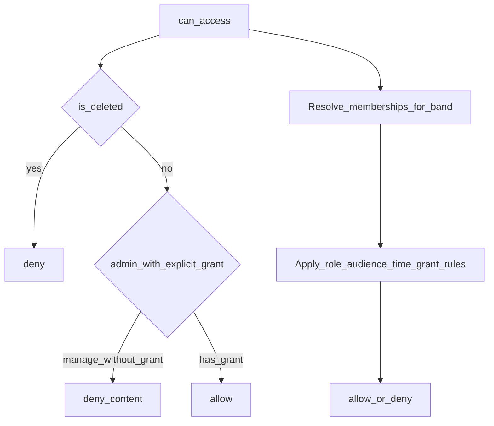

# Access control (XACML 3.0)

Content authorization decisions are taken by an **AuthzForce XACML 3.0 PDP** (`authzforce` service in `docker-compose.yml`) using the policy in [`authz/snap-policy.xml`](../authz/snap-policy.xml). Pages call one facade, `can_access`, which builds the XACML request, sends it to AuthzForce and enforces the decision. The rules below are what the policy implements.

## Policy surface

```text
can_access(user, content_item, action) -> allow | deny
```

| Argument | Meaning |
|----------|---------|
| `user` | Authenticated principal (or anonymous → deny for non-public future cases) |
| `content_item` | Target resource |
| `action` | `view` \| `stream` \| `download` \| `manage` |

`manage` covers edit metadata, replace/delete file, and change permissions/grants.

Every evaluation that backs a user-facing view/stream/download (and optionally manage) should produce an `access_logs` row.

## Inputs to a decision



Decision order (recommended):

1. If `content_item.is_deleted` → deny (except future admin recovery tools).
2. If explicit active `content_grants` for `(user, item, action)` within validity window and not revoked → **allow**.
3. If user is `administrator` with no grant → **deny** for content actions (`view`/`stream`/`download`/`manage`). Admins still access Admin Panel and access logs via separate checks.
4. Apply role + audience + time-window rules for the item's `band_id`.
5. Else → deny.

## Role rules (for band SNAP)

Assume memberships are scoped to the content item's band unless noted.

### Administrator

| Capability | Allowed? |
|------------|----------|
| Admin panel, invites, roles | Yes (not via `can_access` on content) |
| View/stream/download band content | Only with explicit grant |
| Manage content | Only with explicit grant |
| View access logs | Yes (all bands) |

### Band Member

| Capability | Allowed? |
|------------|----------|
| `manage` on own band's items | Yes |
| `view` / `stream` / `download` on own band's items | Yes |
| Other bands | No (unless grant or other membership) |

### Crew / Management

| Capability | Allowed? |
|------------|----------|
| Categories oriented to tour/schedule: `schedule`, `setlist`, `tour_rider`, and other items with `audience_level` in (`crew`, `public`) | `view` (and `download` if appropriate) |
| Demos/masters/contracts at `band` / `restricted` | No unless grant |
| `manage` | No |

Exact crew category set: `schedule`, `setlist`, `tour_rider` plus any item with `audience_level = crew`. See [CONTENT_TYPES.md](CONTENT_TYPES.md).

### Press / Partner

| Capability | Allowed? |
|------------|----------|
| Item with `audience_level` in (`press`, `public`) or `is_public` | After press window |
| `audience_level` in (`fan_club`, `crew`, `band`, `restricted`) | No unless grant |
| Time window | `now >= available_from_press` if set; if null, treat as immediately available for press-level items |
| `manage` | No |

### Fan club member

| Capability | Allowed? |
|------------|----------|
| `audience_level` in (`fan_club`, `public`) or `is_public` | After fan window |
| Press-only / crew / band / restricted | No unless grant |
| Time window | `now >= available_from_fans` if set; if null, immediate for fan_club-level items |
| `manage` | No |

### Registered user

| Capability | Allowed? |
|------------|----------|
| `is_public = true` or `audience_level = public` | Yes (`view`; stream/download per product choice — default allow both for public) |
| Everything else | No unless grant |

## Audience level summary

| Audience level | Who gets role-based access (after windows) |
|----------------|--------------------------------------------|
| `public` | Registered+ (and everyone above) |
| `fan_club` | Fan club, band members |
| `press` | Press, band members |
| `crew` | Crew, band members |
| `band` | Band members only |
| `restricted` | Explicit grants only (+ band members who can still `manage`) |

Band members always retain `manage` and full access to their band's items regardless of audience level (they own the catalog).

## Time windows

| Field | Applies to |
|-------|------------|
| `available_from_press` | Press role accessing press-tier (or public) material |
| `available_from_fans` | Fan club accessing fan-tier (or public) material |

Band members and crew (for crew-visible categories) are **not** blocked by press/fan embargo dates unless a future rule says otherwise. Embargoes exist to protect pre-release leaks to press/fans.

## Grants

An active grant allows the specified `action` when:

- `revoked = false`
- `valid_from` is null or `<= now`
- `valid_until` is null or `>= now`

Grants can open access early for a journalist, extend download rights, or give an admin temporary access to one file.

## Separate capability checks (not content `can_access`)

| Capability | Rule |
|------------|------|
| Open Admin Panel | `role = administrator` |
| Invite users | `administrator` |
| Upload new content | `band_member` for target band |
| View access log for item | `administrator` OR `band_member` of item's band |

## Logging

| Event | Log |
|-------|-----|
| Allowed view/stream/download | `outcome = allowed` |
| Denied attempt | `outcome = denied`, set `deny_reason` (e.g. `embargo`, `role`, `restricted`, `deleted`) |
| Manage actions | Optional but recommended |

## XACML 3.0 / AuthzForce implementation

| XACML role | Component |
|------------|-----------|
| PEP (enforcement) | Flask routes via `can_access` (`app/policy.py`): 403 + access log on Deny |
| PIP (attributes) | `app/policy.py::_xacml_attributes` reads memberships, grants and item metadata from PostgreSQL |
| PDP (decision) | AuthzForce `POST /authzforce-ce/domains/{id}/pdp` |
| PAP (policy admin) | AuthzForce REST API; `app/xacml.py::init_pdp` creates the `snap-records` domain and loads the policy at startup |

### Request attributes

| Category | AttributeId | Type | Source |
|----------|-------------|------|--------|
| Subject | `urn:oasis:names:tc:xacml:1.0:subject:subject-id` | string | user id |
| Subject | `urn:snap:subject:status` | string | `active` / `pending` / `disabled` |
| Subject | `urn:oasis:names:tc:xacml:2.0:subject:role` | string bag | memberships for the item's band (+ `administrator`) |
| Subject | `urn:snap:subject:granted-action` | string bag | actions with an active, non-revoked grant on this item |
| Resource | `urn:oasis:names:tc:xacml:1.0:resource:resource-id` | string | content item id |
| Resource | `urn:snap:resource:band-id`, `:category`, `:audience-level` | string | content item |
| Resource | `urn:snap:resource:is-deleted`, `:is-public` | boolean | content item |
| Resource | `urn:snap:resource:available-from-press`, `:available-from-fans` | dateTime | embargo dates (absent = no embargo) |
| Action | `urn:oasis:names:tc:xacml:1.0:action:action-id` | string | `view` / `stream` / `download` / `manage` |
| Environment | `urn:oasis:names:tc:xacml:1.0:environment:current-dateTime` | dateTime | request time (embargo check is done in the policy) |

### Policy

`snap-root` PolicySet (deny-unless-permit) → `snap-content-access` Policy (first-applicable), one rule per line of the decision order above. Every Deny rule returns the advice `urn:snap:advice:deny` with a `deny-reason` (`embargo`, `role`, `restricted`, `deleted`, `admin_needs_grant`, `unauthenticated`) that is written to `access_logs`.

**Changing the policy:** edit `authz/snap-policy.xml`, bump `Version` on the `PolicySet`, restart `web`. The app uploads the new version and pins the PDP to it.

### Fail closed

`NotApplicable`, `Indeterminate`, timeouts or an unreachable PDP are all treated as **Deny** (`pdp_unavailable` / `pdp_indeterminate` in the access log).

### Security of the PDP

AuthzForce's REST API (including the PAP that can replace policies) has no authentication, so the container is only on the internal compose network: no host port is published.

### Local development and tests

Without `AUTHZFORCE_URL` (e.g. `python run.py`), `can_access` falls back to `local_can_access`, a Python reference implementation of the same rules. `tests/test_xacml.py` checks that AuthzForce and the reference give identical decisions and deny reasons over ~2,900 combinations of role, audience, action, embargo, grant, deletion and account status:

```bash
docker compose run --rm -e AUTHZFORCE_URL=http://authzforce:8080 web sh -c "pip install -q pytest && python -m pytest tests"
```

Only content decisions go through XACML; admin panel, upload and access-log page checks (`can_admin`, `can_upload`, `can_view_logs`) stay in Python.

## Related docs

- [DATA_MODEL.md](DATA_MODEL.md)  
- [PAGES.md](PAGES.md)  
- [CONTENT_TYPES.md](CONTENT_TYPES.md)  
