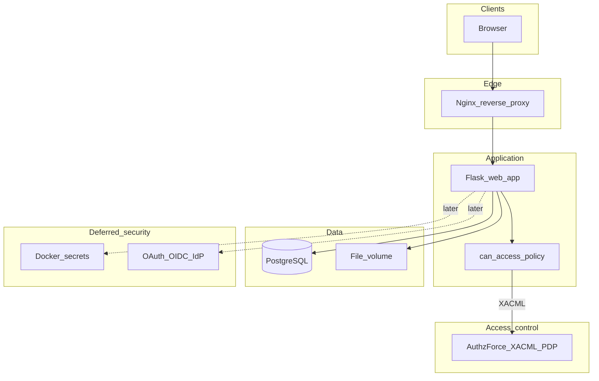
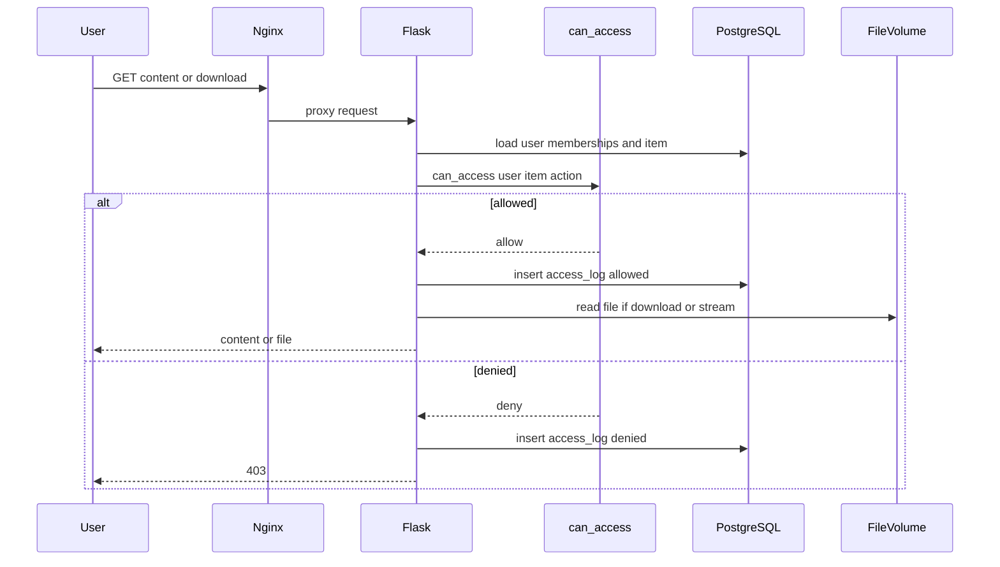
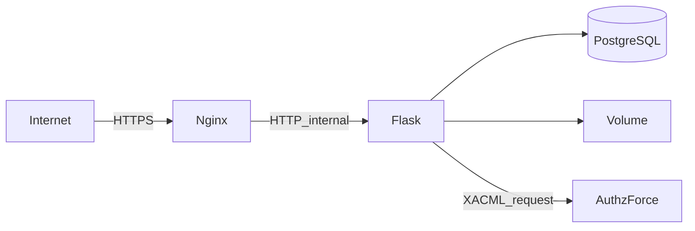

# Architecture

## Overview

SNAP Records is planned as a small containerized web stack. **Design phase only** — components below are target architecture, not deployed yet.

**In scope when building:** Nginx (optional early; required for TLS later), Flask app, PostgreSQL, file volume.

**Access control:** AuthzForce XACML 3.0 PDP (see [ACCESS_CONTROL.md](ACCESS_CONTROL.md)).

## Component diagram



## Responsibilities

| Component | Responsibility |
|-----------|----------------|
| Nginx | Terminate TLS with a certificate signed by the SNAP Root CA (`certs_gen.sh`), redirect HTTP→HTTPS, HSTS and security headers, forward HTTP to Flask |
| Flask | Pages, forms, session auth, upload/download, permission UI, access logging, in-app authorization |
| `can_access` | Single policy entrypoint (PEP/PIP): gathers role, membership, audience, time window and grant attributes and asks the XACML PDP |
| PostgreSQL | Label, bands, users, memberships, invitations, content metadata, grants, access logs. Later: wrapped file keys, encrypted fields |
| File volume | Stored content blobs. Later: ciphertext only |
| AuthzForce | XACML 3.0 PDP/PAP evaluating `authz/snap-policy.xml`; internal network only |
| Docker secrets | Deferred master keys, DB credentials, OAuth client secret |
| OAuth / OIDC | Deferred fan Google login |

## Request flow (authenticated content access)



## Deployment sketch (Phase 2+)

Suggested layout when implementation starts (not created in design phase):

```text
project/
  docs/                 # design (exists)
  app/                  # Flask package
  migrations/           # DB migrations
  docker-compose.yml    # web, db, volume; nginx later
  .env.example          # non-secret defaults
```

Single label means no tenant router and no per-label DB. One PostgreSQL database; one `labels` row: SNAP Records.

## Trust boundaries (for later security work)



Until Phase 3, treat the app as a local/dev service with simple auth. Do not claim production-hardening.

## Related docs

- [PLAN.md](PLAN.md) — roadmap and deferred features  
- [DATA_MODEL.md](DATA_MODEL.md) — what PostgreSQL stores  
- [ACCESS_CONTROL.md](ACCESS_CONTROL.md) — policy rules behind `can_access`  
